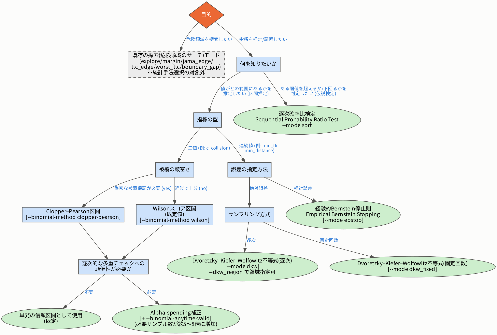
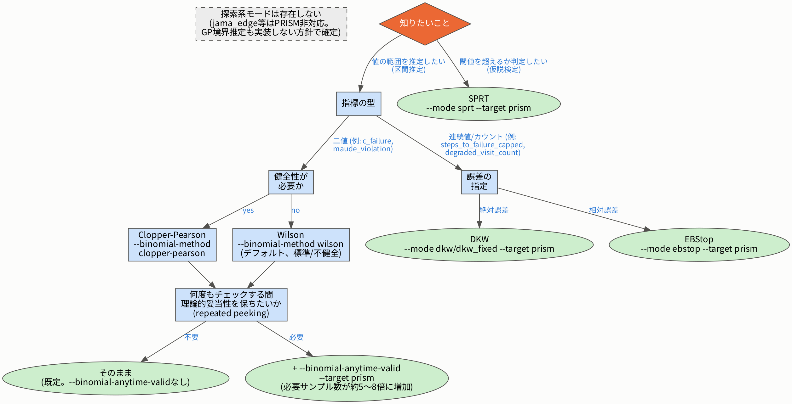

# 統計手法選択の決定木

Decision trees for choosing a statistical method. **[English version below ↓](#english)**

このドキュメントは、PyDSMC(Gros et al., QEST 2025)の Fig.4「Automated statistical method
selection」を参考に、AWSIM_launch でどの統計手法(`--mode`/`--binomial-method`)を選ぶべきかを
人間が手動で判断する際の参考図です。

PyDSMC の図とは異なり、**これは自動選択ロジックではありません**。AWSIM_launch では
`--mode`/`--binomial-method` は現在も利用者が明示的に指定する必要があり、この図はその判断を
助けるための参考資料という位置づけです。

## なぜ AWSIM 用と PRISM 用で2本に分かれているか

AWSIM と PRISM は「デフォルトの指標が違う」という程度の差ではなく、**実行アーキテクチャそのもの
が異なります**。

- **AWSIM**: `orchestration/strategy.py::ActiveLearningStrategist` という1つの汎用エンジンが、
  危険領域を探索する系のモード(`explore`/`margin`/`jama_edge`/`ttc_edge`/`worst_ttc`/
  `boundary_gap`)と、指標を推定・証明する系のモード(`binomial_ci`/`dkw`/`dkw_fixed`/`sprt`/
  `ebstop`)の両方を扱う。
- **PRISM**: `orchestration/fixed_parameter_sampling.py::FixedParameterSamplingStrategy` という
  薄い実行経路のみを持つ。`--param key=value` で固定した1点を独立に繰り返しサンプリングするだけで、
  **探索系のモードは存在しない**(`jama_edge` 等は非対応と`docs/prism_integration_plan.md`で
  既に文書化済み。GP境界推定も「実装しない」と`2026-09-17`に決定済み)。

そのため PRISM 側のツリーは、単に葉が違うだけでなく **探索の分岐が最初から存在しない、
構造的に浅い木** になっています。

## AWSIM 用



## PRISM 用



**`2026-09-18`更新**: `DKW`(`--mode dkw`/`dkw_fixed --target prism`)は
`orchestration/prism_dkw_sampling.py::PrismDkwSamplingStrategy`としてライブ実行に対応した。
既存の`DKWModeRunner`(AWSIMの`--mode dkw`/`dkw_fixed`と共通のステージ制alpha-spendingエンジン)
を、常に同じ固定パラメータ点を返す`get_random_point`で駆動することで、DKWの数式やステージ制御
ロジックを一切書き直さずに再利用している。ただし、コールドスタート(標本0件)から始まる点はAWSIM
の通常利用と異なるため専用の対処が必要だった。実装当初、標本1件で区間幅が数学的に0になり誤って
「収束」と判定される既知の挙動があったが、`2026-09-19`に`evaluation/dkw.py`側でn<2を「収集継続」
として扱うよう修正済み(詳細は`docs/prism_integration_plan.md`の「DKW」節を参照)。この修正の過程
で、`DKWModeRunner.handle_sequential`が`max_samples`を全くチェックしていない、より深刻な既存
バグ(AWSIM側にも影響する共通コード)も発見・修正した。

以前は`--target prism --mode dkw`を実行してもエラーにならず、統計評価を一切行わないまま1回だけ
ケースを実行して静かに終了する不具合があった。現在は`apps/cli/orchestrator_main.py::validate_args`
と`orchestration/orchestrator.py::_build_strategy`の両方に明示的なガードを追加しており、
`explore`/`binomial_ci`/`sprt`/`ebstop`/`dkw`/`dkw_fixed`以外のモードを`--target prism --param ...`
と組み合わせると`ValueError`で即座に拒否される。

## 各手法の解説(統計に詳しくない人向け)

ツリーの葉ノードは、CLIコマンド名ではなく学術的な名称を主見出しにしています。それぞれ何を
している手法か、簡潔に説明します。

大きく2つの目的があります。

- **区間推定**: 「真の値はこの範囲にある」と言える区間を計算する。区間が狭いほど精度が高いが、
  そのぶん多くのサンプルが必要になる。
- **仮説検定**: 「真の値はある閾値を超えているか、下回っているか」を二択で判定する。

**Wilsonスコア区間 / Clopper–Pearson区間**(二値指標の区間推定): 指標が0か1(例: 衝突した/
しなかった)のときの信頼区間。Wilsonスコア区間は正規分布近似を使う軽量な方法だが、サンプル数が
少ない・真の確率が0や1に近いと、名目の信頼水準を実際のカバレッジが下回ることがある。
Clopper–Pearson区間は近似を使わず直接計算するため、名目の信頼水準を下回らないことが保証される
(代わりに区間はやや広めになる)。安全性に関わる最終判断にはClopper–Pearsonを推奨。

**逐次確率比検定(Sequential Probability Ratio Test)**(仮説検定): 「真の確率はp0以上か、p1
以下か」という二択を、サンプルを1つずつ追加しながら逐次的に判定する。尤度比を更新し、閾値を
超えたら判定を確定する。何度サンプルを追加してチェックしても、判定の誤り率が指定値を超えない
ことが構造的に保証されている。

**Dvoretzky–Kiefer–Wolfowitz不等式**(連続値・カウントの区間推定、絶対誤差): 経験分布関数と
真の分布関数との差を、分布の形を仮定せずサンプル数だけから抑えられる不等式。これを使って任意の
分位点の信頼区間を計算する。DKW不等式の保証が成り立つのは、評価対象の分布から一様・独立に
引いた標本で、**1回だけ**評価する場合である。

- 固定サンプル数版(`--mode dkw_fixed`)は、先に決めた数 n だけ集めてから1回だけ評価する。
  一様標本だけ(`--dkw-pure-smc`、または過去の探索データを引き継がない新規実行)であれば
  **DKW不等式の保証がそのまま成り立つ**。必要な n は事前に n ≥ ln(2/δ)/(2ε²) で決める
  (例: ε=0.02, δ=0.05 で n ≥ 4,611。`--dkw-simultaneous` では δ を指標数で割る)。
- 逐次版(`--mode dkw`)は、サンプルを増やしながら区間幅が目標値以下になった時点で止める。
  誤り率予算はステージ単位(第kステージに δ/2^k)で配分しているが、評価は新しい標本を発行する
  たびに毎回行うため、**同じステージ内での繰り返しの確認は予算に含まれていない**。そのため
  逐次版の区間は**近似**である。`--dkw-pure-smc` を付けないと、探索データをKDEで推定した重みで
  再利用するため、さらに近似が重なる。
- `--mode dkw_fixed` で過去の探索データ(`--resume-from`)が混ざり、`--dkw-pure-smc` を付けない
  場合は、偏った標本を重みなしで使うため**保証は成り立たない**。

評価結果の `diagnostics.guarantee` に、どれに当たるかが記録される
(`dkw` / `approximate_sequential` / `approximate_sequential_kde` / `none_mixed_samples`)。
`dkw` 以外の場合は、実行時に1回だけ注意が表示される。

**経験的Bernstein停止則(Empirical Bernstein Stopping)**(連続値・カウントの区間推定、相対
誤差): DKWと同じく連続値・カウント指標が対象だが、目標が絶対誤差でなく相対誤差である点が異なる。
実測した分散を使って停止判定するため、真の分散が小さい指標ほど少ないサンプル数で収束できる。
サンプル数ごとの誤り率予算をあらかじめ配分しておくことで、毎回チェックしても全体の誤り率が
保証値を超えないよう設計されている。

**Alpha-spending補正**(`--binomial-anytime-valid`): Wilson/Clopper–Pearson区間は本来「1回
だけ計算する」ことを前提にした数式だが、`binomial_ci`モードはサンプルが増えるたびに何度も区間を
計算し直し、目標幅に達したら停止する設計。何度も結果を覗き見て都合の良いタイミングで止めると、
見かけの信頼水準より実際の誤り率が悪化しうる(**repeated peeking問題**)。`--binomial-anytime-valid`
は、EBStopと同じ考え方(誤り率予算の事前配分)をWilson/Clopper–Pearson区間に適用し、何度
チェックしても全体の誤り率が保証値を超えないことを保証する。代償として、同じ目標幅に到達する
のに必要なサンプル数が実測でおよそ5〜8倍に増えるため、既定では無効(オプトイン)。

`sprt`・`ebstop`は、設計自体に何度も覗き見ることへの保護が組み込まれているため、
`binomial_ci`のような追加のオプトインは不要。`--mode dkw`はステージ単位の予算配分だけで、
ステージ内の繰り返しの確認は保護されていない(上記のDKWの解説を参照)。保証が必要な場合は
`--mode dkw_fixed`を使う。

## 各決定軸の意味(クイックリファレンス)

| 軸 | 選択肢 | 対応する既存概念 |
|---|---|---|
| 知りたいこと | 区間推定 / 仮説検定(閾値判定) | 前者=`binomial_ci`/`dkw`/`ebstop`、後者=`sprt` |
| 指標の型 | 二値(0/1) / 連続値・カウント | `StatisticalTargetProfile.binary_metric` / `.dkw_metric` |
| 健全性(二値の場合) | 健全(sound) / 標準(CLT近似、不健全) | `clopper-pearson` / `wilson`(詳細は上記の解説参照) |
| 誤差の指定(連続値の場合) | 絶対誤差 / 相対誤差 | `dkw`系 / `ebstop` |
| 設定(DKWの場合) | 逐次(早く止まるが近似) / 固定回数(保証あり、一様標本のとき) | `--mode dkw` / `--mode dkw_fixed`(AWSIM/PRISM共通) |
| repeated peeking対策(二値の場合) | 不要(既定) / 必要 | なし / `--binomial-anytime-valid` |

## 元のDOTソース

`docs/diagrams/awsim_tree.dot` / `docs/diagrams/prism_tree.dot` に Graphviz の DOT
ソースを置いています。再生成する場合は以下を実行してください。

```bash
dot -Tpng -Gdpi=150 docs/diagrams/awsim_tree.dot -o docs/diagrams/awsim_tree.png
dot -Tpng -Gdpi=150 docs/diagrams/prism_tree.dot -o docs/diagrams/prism_tree.png
```

---

<a id="english"></a>

# English: Decision trees for choosing a statistical method

This document is a reference diagram for deciding by hand which statistical method (`--mode` / `--binomial-method`) to use in
AWSIM_launch. It is modeled on Fig. 4, "Automated statistical method selection", of PyDSMC (Gros et al., QEST 2025).

Unlike the PyDSMC figure, **this is not automatic selection logic**. In AWSIM_launch, users still specify `--mode` /
`--binomial-method` explicitly; this diagram is a reference to help with that decision.

## Why there are separate trees for AWSIM and PRISM

AWSIM and PRISM differ not just in their default metrics but **in their execution architecture**.

- **AWSIM**: one general engine, `orchestration/strategy.py::ActiveLearningStrategist`, handles both the modes that explore dangerous
  regions (`explore` / `margin` / `jama_edge` / `ttc_edge` / `worst_ttc` / `boundary_gap`) and the modes that estimate or verify a
  metric (`binomial_ci` / `dkw` / `dkw_fixed` / `sprt` / `ebstop`).
- **PRISM**: has only a thin execution path, `orchestration/fixed_parameter_sampling.py::FixedParameterSamplingStrategy`. It samples one
  point fixed by `--param key=value` independently and repeatedly, and **has no exploration modes** (unsupported modes such as
  `jama_edge` are documented in `docs/prism_integration_plan.md`, and GP boundary estimation was decided not to be implemented on
  2026-09-17).

So the PRISM tree is not just the AWSIM tree with different leaves; it is **structurally shallower, with no exploration branch at
all**.

## For AWSIM


## For PRISM


**Update 2026-09-18**: DKW (`--mode dkw` / `dkw_fixed --target prism`) now runs live as
`orchestration/prism_dkw_sampling.py::PrismDkwSamplingStrategy`. It drives the existing `DKWModeRunner` (the same stage-based
alpha-spending engine as AWSIM's `--mode dkw` / `dkw_fixed`) with a `get_random_point` that always returns the same fixed parameter
point, so neither the DKW formulas nor the stage control had to be rewritten. Starting cold (from zero samples), unlike normal AWSIM
use, needed special handling. Initially, a single sample produced an interval width of exactly 0 and was wrongly judged as converged;
on 2026-09-19 `evaluation/dkw.py` was fixed to treat n < 2 as "keep collecting" (see the DKW section of
`docs/prism_integration_plan.md`). While fixing this, a more serious existing bug in shared code that also affects AWSIM was found and
fixed: `DKWModeRunner.handle_sequential` did not check `max_samples` at all.

Previously, `--target prism --mode dkw` did not raise an error; it silently ran one case without any statistical evaluation and exited.
There are now explicit guards in both `apps/cli/orchestrator_main.py::validate_args` and
`orchestration/orchestrator.py::_build_strategy`, so combining `--target prism --param ...` with any mode other than `explore` /
`binomial_ci` / `sprt` / `ebstop` / `dkw` / `dkw_fixed` is rejected immediately with a `ValueError`.

## The methods explained (for readers new to statistics)

The leaves of the trees are labeled with the academic names of the methods rather than CLI command names. Here is a short
explanation of what each method does.

There are two broad goals.

- **Interval estimation**: compute an interval such that we can say "the true value is in this range". Narrower intervals are more
  precise but need more samples.
- **Hypothesis testing**: decide between two options, "the true value is above a threshold" or "below it".

**Wilson score interval / Clopper–Pearson interval** (interval estimation for binary metrics): confidence intervals for a metric that
is 0 or 1 (for example, collided / did not collide). The Wilson score interval is a lightweight method based on a normal
approximation; with few samples or a true probability close to 0 or 1, its actual coverage can fall below the nominal confidence level.
The Clopper–Pearson interval is computed exactly without approximation, so it is guaranteed never to fall below the nominal level
(at the cost of a somewhat wider interval). Clopper–Pearson is recommended for final safety decisions.

**Sequential probability ratio test** (hypothesis testing): decides between "the true probability is at least p0" and "at most p1"
sequentially, adding one sample at a time. It updates the likelihood ratio and commits to a decision when a threshold is crossed. By
construction, the error rate of the decision does not exceed the specified value however many times samples are added and checked.

**Dvoretzky–Kiefer–Wolfowitz inequality** (interval estimation for continuous or count metrics, absolute error): an inequality that
bounds the difference between the empirical and the true distribution function from the sample size alone, without assuming the
shape of the distribution. It is used to compute a confidence interval for any quantile. The DKW inequality's guarantee holds when the
samples are drawn uniformly and independently from the target distribution and are evaluated **only once**.

- The fixed-sample version (`--mode dkw_fixed`) collects a predetermined number n of samples and evaluates once. With uniform samples
  only (`--dkw-pure-smc`, or a new run that does not carry over exploration data), **the DKW guarantee holds as is**. Choose n in
  advance with n ≥ ln(2/δ)/(2ε²) (for example, n ≥ 4,611 for ε = 0.02 and δ = 0.05; with `--dkw-simultaneous`, divide δ by the number
  of metrics).
- The sequential version (`--mode dkw`) adds samples and stops once the interval width falls to the target. The error budget is split
  per stage (δ/2^k for stage k), but the interval is evaluated every time a new sample is issued, so **repeated checks within the same
  stage are not covered by the budget**. The sequential interval is therefore **an approximation**. Without `--dkw-pure-smc`, it also
  reuses exploration data with weights estimated by KDE, which adds another approximation.
- If `--mode dkw_fixed` is run with past exploration data (`--resume-from`) mixed in and without `--dkw-pure-smc`, biased samples are
  used without weights, and **the guarantee does not hold**.

Each evaluation records which of these applies in `diagnostics.guarantee`
(`dkw` / `approximate_sequential` / `approximate_sequential_kde` / `none_mixed_samples`).
If it is not `dkw`, a notice is printed once at run time.

**Empirical Bernstein Stopping** (interval estimation for continuous or count metrics, relative error): like DKW, it targets continuous
or count metrics, but the target is a relative error rather than an absolute one. It stops based on the observed variance, so metrics
with a small true variance converge with fewer samples. Because the error budget is allocated to each sample size in advance, the overall
error rate stays within the guaranteed value even when checked every time.

**Alpha-spending correction** (`--binomial-anytime-valid`): the Wilson / Clopper–Pearson formulas assume the interval is computed only
once, but `binomial_ci` recomputes the interval every time a sample is added and stops when the target width is reached. Looking at the
results repeatedly and stopping at a convenient moment can make the actual error rate worse than the apparent confidence level (**the
repeated peeking problem**). `--binomial-anytime-valid` applies the same idea as EBStop (allocating the error budget in advance) to the
Wilson / Clopper–Pearson intervals and guarantees that the overall error rate stays within the guaranteed value however often it is
checked. In exchange, the number of samples needed to reach the same target width grows by about 5–8 times in practice, so it is off by
default (opt-in).

`sprt` and `ebstop` have protection against repeated peeking built into their design, so they need no opt-in like `binomial_ci`.
`--mode dkw` only splits the budget per stage and does not protect repeated checks within a stage (see the DKW explanation above). Use
`--mode dkw_fixed` when a guarantee is required.

## Meaning of each decision axis (quick reference)

| Axis | Options | Corresponding concept |
|---|---|---|
| What you want to know | Interval estimation / hypothesis test (threshold decision) | The former = `binomial_ci` / `dkw` / `ebstop`, the latter = `sprt` |
| Type of metric | Binary (0/1) / continuous or count | `StatisticalTargetProfile.binary_metric` / `.dkw_metric` |
| Soundness (binary) | Sound / standard (CLT approximation, unsound) | `clopper-pearson` / `wilson` (see the explanation above) |
| Error specification (continuous) | Absolute / relative error | `dkw` family / `ebstop` |
| Setting (DKW) | Sequential (stops early, approximate) / fixed count (guaranteed with uniform samples) | `--mode dkw` / `--mode dkw_fixed` (shared by AWSIM and PRISM) |
| Protection against repeated peeking (binary) | Not needed (default) / needed | none / `--binomial-anytime-valid` |

## DOT sources

The Graphviz DOT sources are `docs/diagrams/awsim_tree.dot` / `docs/diagrams/prism_tree.dot`. To regenerate the images, run:

```bash
dot -Tpng -Gdpi=150 docs/diagrams/awsim_tree.dot -o docs/diagrams/awsim_tree.png
dot -Tpng -Gdpi=150 docs/diagrams/prism_tree.dot -o docs/diagrams/prism_tree.png
```
